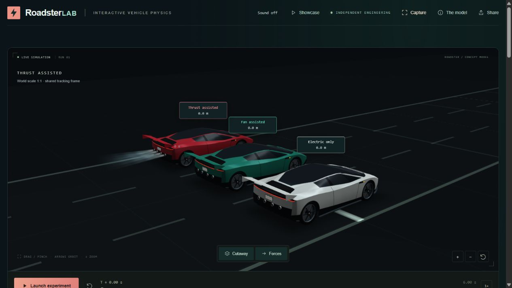
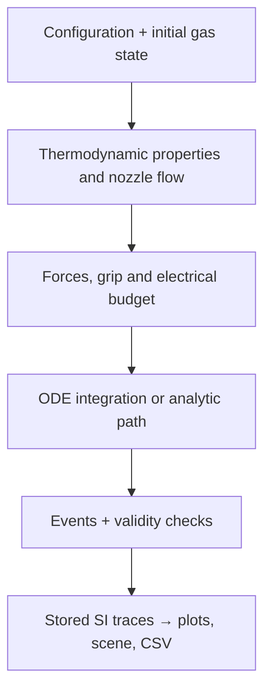

# RoadsterLAB

**An interactive vehicle-physics lab by Albert Gil-Esmendia.**

What changes when a car can use fan suction and a finite supply of compressed air?
RoadsterLAB connects vehicle dynamics, real-gas thermodynamics, nozzle flow and
contact mechanics in four interactive experiments. A procedural 3D vehicle,
parameter workspace, force vectors, pressure-vessel cutaway and synchronized plots
make the model visible while you explore it.

[Live project](https://albert-gil.github.io/RoadsterLAB/) · [Source](https://github.com/Albert-Gil/RoadsterLAB) · [Google Scholar](https://scholar.google.com/citations?user=R_3V20cAAAAJ&hl=en)



This is an independent engineering portfolio project inspired by the Roadster.
**All vehicle/component inputs are illustrative assumptions.** The model is not
calibrated to Tesla performance data and is not an official Tesla simulator.

## Try the experiments

| Experiment | Question | Model |
|---|---|---|
| **Launch** | How do grip, fan suction and direct thrust affect acceleration? | Three independent rear-drive launches with identical starting hardware/inventory. |
| **Hop** | Can the remaining air brake a vertical landing? | Variable-mass vertical flight, ballistic/automatic/manual return and pre-run landing prediction. |
| **Invert** | Can suction maintain contact while a platform rotates? | Guided body rotation, normal/tangential contact loads, friction, sliding, seal loss and ballistic departure. |
| **Turn** | Can the same speed and steering stay inside the lane? | Two independent constant-speed bicycle paths with a friction-circle curvature cap and grass runoff. |

1. Select an experiment and a camera.
2. Click **Parameters** to open the optional side panel (below the scene on phones). Start with
   a preset; the nearby hints explain which variables matter.
3. Change a slider or enter a numeric value. Results recalculate at the same paused
   simulation time; `--` denotes a pending calculation.
4. Choose **Replay with these values**, scrub the timeline, or inspect force vectors
   and the cutaway. Plots and telemetry share the simulation clock.
5. Export **CSV** for numerical results, or **Share** for the active setup.

Sliders use practical increments; numeric fields allow deliberate precise values.
Each experiment remembers its configuration within the session. Repeated Launch
runs retain the selected car's remaining gas mass and internal energy; refilling
is explicit. Switching other experiments does not refill that inventory.

## Run locally

Requires **Node.js 24+**. No npm dependencies, external assets or framework install.
From the repository root:

```sh
cd impulse
node scripts/build.mjs
node scripts/serve.mjs
```

Open **http://127.0.0.1:4173/**. To run offline, open
`impulse/dist/roadsterlab.html` directly; it embeds the renderer, styles, physics and
worker. `impulse.html` remains a compatibility alias. Rebuild after editing source.

```sh
# From impulse/
node scripts/build.mjs
node --experimental-strip-types --test tests/*.test.*
```

## Showcase and video export

**Showcase** runs a 36-second tour: Launch → Hop → Invert → Turn. Its four example
setups are computed before playback. Tour time is presentation time; **T+** is
physical simulation time. Chapters include endpoint holds and camera changes.

Choose **Showcase → Export video → Landscape / Portrait** to record a fixed-size,
captioned clip. Output is **1920 × 1080** or **1080 × 1920**, with a 30 fps target,
calculated results, a compact physics equation and author credit. MP4 is selected
when supported by the browser, with WebM as fallback. The tour/export is silent.
Recording takes about 36 seconds and requires the tab to stay visible. A separate
render scene preserves the output framing when the browser window changes size.
Download the video before exiting the tour. Cancel, backgrounding or Exit stops the
recording; Exit restores the saved experiment, parameters, time and tank state.

Physics is independent of animation/recording rate. Camera moves, paint, plumes,
debris and conceptual sound are presentation effects, not CFD or structural
simulation. Enable **Sound** for the simulation-driven audio system described below.

Parameters are hidden on initial load, leaving the scene and results full-width.
The large **Parameters** button beside Launch/Replay toggles the nonmodal panel;
the top bar provides another entry. **×** or **Escape** closes it.
Opening it pauses playback. Replay closes it and returns to the vehicle. The main
experiment button and timeline sit directly under the scene, above live telemetry.

## Simulation-Driven Audio System

The 17 supplied ElevenLabs recordings now form shared, simulation-driven layers.
They are conceptual effects, **not actual Tesla recordings or validated acoustic
predictions**. Sound defaults to on; open **Parameters → Sound settings** for separate
music/effects volumes (zero mutes either). Preferences persist locally. Music keeps
its phase across modes and pauses; hidden pages and silent video export mute both.

| Mode | Sound allocation and governing quantities |
| --- | --- |
| Launch | Three speed-blended motor bands; speed-dependent aero; actual gas force/flow drives thrust start/loop/stop; fan operating power and leakage airflow drive suction/leakage; traction-limited status adds scrub. |
| Invert | Dominant suction start/loop/stop from actual supported suction/power; orifice airflow drives leakage; contact load and relative deck sliding drive surface/scrub/skid; speed drives aero. No powered-wheel model. |
| Hop | Dominant thrust start/loop/stop from delivered force/flow; vertical speed drives aero. No airborne road drivetrain or tire sounds. |
| Turn | Steady speed-hold motor/aero; subtle selected-case fan/leakage; combined drive/lateral friction utilization drives progressive scrub. No invented tire-slip dynamics or collision sounds for grass runoff. |

The motor uses equal-power blends at 0/25/60 m/s with modest pitch variation; these
are perceptual speed mappings, not calculated RPM. Startup/shutdown recordings fire
on state edges, crossfading into sustained loops. Leakage follows the existing
orifice flow, including electrical-budget clamps; surface sounds require actual
Invert contact/sliding. Turn provides a grip-capped geometric path but no solved
slip angle/ratio, so its saturation adds scrub without asserting skid dynamics.
Only supported WRECKED Hop/Invert ground contacts trigger minor/major impact files;
ordinary landings, scrubbing and unresolved model limits remain free of impacts.

One centralized Web Audio manager reuses decoded buffers and 11 persistent loop
voices. Smoothed gain automation, separate buses, music ducking, compression and a
bounded safety stage control the mix. Music ducks for thrust/major collisions.
Recordings load when automatic audio startup is allowed, or after the first user
interaction; explicit mute is remembered and missing files degrade gracefully.
Original stereo 48 kHz/16-bit WAVs are preserved. Processed WAVs retain stereo for
music/aero/major wreck, use mono elsewhere, crossfade loop boundaries and apply
conservative RMS/peak levels. Browser assets total 11.31 MB; standalone HTML embeds
them for offline use. No runtime dependencies or physical models were changed.

Adjust `AUDIO_MIX` in `impulse/src/audio-mapping.js`; replace recordings through
`impulse/scripts/prepare-audio.py`, then rebuild. The complete file allocation,
physical inputs, sound-design thresholds, processing catalog, lifecycle and
listening checklist are in [the audio guide](impulse/docs/AUDIO.md).

**Audio licensing confirmed:** the user confirmed Creator-plan ownership and
licensing rights for the supplied sounds. `impulse/assets/audio/RIGHTS.json` records
the confirmation, and the audio deployment check passes. Credit: ElevenLabs.
Subjective listening and physical iOS testing remain open; this update has not
been published.

## The reduced-order model

The aim is to retain the governing balances and dominant constraints while keeping
parameter exploration interactive. There is no mesh-based CFD, finite-element
structure, resolved tire contact patch or full multibody vehicle solver.

The state/constraint hierarchy is:



### 1. Vehicle forces, contact and electrical power

Let $M=M_\mathrm{dry}+m_\mathrm{gas}$ be total vehicle mass. Launch solves

$$
\dot x=v,\qquad M\dot v=F_\mathrm{tire}+F_\mathrm{jet}-D-F_\mathrm{roll}.
$$

The air inventory decreases during discharge; jet momentum is already included in
$F_\mathrm{jet}$. Drag and aerodynamic load use fixed effective areas:

$$
D=\tfrac12\rho_a(C_DA)v^2,\quad
F_\mathrm{aero}=\tfrac12\rho_a(C_LA)v^2,\quad
F_\mathrm{roll}=C_\mathrm{rr}(Mg+F_\mathrm{fan}+F_\mathrm{aero}).
$$

Rolling resistance is zero at rest. Assumptions are $\rho_a=1.225$ kg/m³,
$C_DA=0.58$ m², $C_LA=0.65$ m² and $C_\mathrm{rr}=0.012$.
Rear tire force satisfies

$$
F_\mathrm{tire}=\min\!\left(F_\mathrm{friction},42\,000,
\frac{\max(P_\mathrm{electrical}-P_\mathrm{fan},0)}{\max(v,0.1)}\right).
$$

The 42 kN cap is a drivetrain torque/gearing surrogate. Rear normal load follows a
quasi-static pitch moment balance, including acceleration, thrust/drag application
heights, and fan/aero loading. Writing it as $N_r=R_0+(h/L)F_\mathrm{tire}$ gives
$F_\mathrm{friction}=\max[0,\mu R_0/(1-\mu h/L)]$. The wheelbase is 2.8 m and
assumed CG height 0.42 m. Front contact loss stops the model rather than inventing
wheelie dynamics. There is no transient slip, suspension or tire relaxation model.

### 2. Fan suction and leakage

An assumed fan pressure-flow curve intersects an orifice seal-leakage curve.
For command fraction $u$, leakage area $A_\ell$ and discharge coefficient
$C_\ell=0.65$:

$$
\Delta p=\frac{\Delta p_\mathrm{stall}u^2}
{1+2\Delta p_\mathrm{stall}(C_\ell A_\ell)^2/(\rho_aQ_\mathrm{free}^2)},
\quad Q=C_\ell A_\ell\sqrt{2\Delta p/\rho_a}.
$$

$$
F_\mathrm{fan}=\Delta p\,A_\mathrm{floor},\qquad
P_\mathrm{fan}=\Delta p\,Q/\eta.
$$

Illustrative constants: stall pressure 11 kPa, free flow 18 m³/s, floor area 4 m²,
efficiency 0.7, and $A_\ell=0.015+0.12(\mathrm{leak}/100)$ m². Launch fan load has
a first-order 0.12 s response. Electrical fan draw shares the vehicle power budget;
it is separate from the platform actuator work in Invert.

### 3. Vessel thermodynamics and gas equation of state

The fixed-volume vessel contains well-mixed dry air. It evolves gas mass $m$ and
specific internal energy $u_g$:

$$
\dot m=-\dot m_e,\qquad
\frac{d(mu_g)}{dt}=\dot Q-\dot m_e h_0,\qquad
\dot Q=UA(T_\mathrm{source}-T_g).
$$

Equivalently, $\dot u_g=[\dot Q+\dot m_e(u_g-h_0)]/m$.
Positive heat rate warms a colder gas; heat exchange continues with closed valves.
The imposed heat-source temperature is a reservoir, **not a separate finite wall**.
Density is $m/V$; an inverse energy solve recovers temperature, then pressure.

A dependency-free **consistent Peng–Robinson dry-air approximation** supplies
$p,u_g,h,s,c_p,c_v$ and sound speed. In molar-volume form,

$$
p=\frac{R_uT}{v_m-b}-\frac{a\alpha(T)}{v_m(v_m+b)+b(v_m-b)}.
$$

Energy and entropy departure functions use the same EOS, retaining $h=u_g+p/\rho$.
The ideal heat-capacity fit varies with temperature; below 200 K it uses an explicit
constant-$c_p$ continuation. The conservative domain is **140–2000 K** and
**0.01–1176.565 kg/m³**, with further thermodynamic stability checks. Unsupported
states return a model-limit status; they do not silently switch to an ideal gas.
The generated filename `air-table.js` is historical: the current implementation is
a direct cubic-EOS calculation, not a NIST/REFPROP property table or phase model.

### 4. Valve, feed losses and nozzle expansion

The nozzle uses real-gas isentropic expansion:

$$
s_e=s_0,\qquad v_e=\sqrt{2(h_0-h_e)},\qquad
\dot m_e=C_dA_t\rho_t v_t,\quad C_d=0.9.
$$

Unchoked flow expands to ambient pressure. Choked flow solves the sonic throat,
$v_t/a_t=1$, using the real-gas sound speed. Thrust includes pressure thrust:

$$
F_\mathrm{jet}=\dot m_e v_e+(p_e-p_a)A_e.
$$

Tank energy removal uses the outflow **stagnation enthalpy** $h_0$; jet kinetic
energy must not be omitted or subtracted twice. Optional settings include:

- Smooth valve opening $f(q)=q^2(3-2q)$ over a prescribed rise time; immediate closure.
- Feed pressure $p_\mathrm{in}=p_a+(p_g-p_a)(1-\lambda)$ with **isenthalpic** throttling.
- Bell exit/throat area ratio 1–1.5, solving the supported supersonic branch when
  choked. A demand for sub-ambient exit pressure uses an explicit separated,
  throat-only approximation. No shock structure or resolved plume is computed.

Valve/duty commands scale mean flow and thrust together. Line inertia, pressure
waves, regulators, valve actuator dynamics and vessel structural mass are omitted.

### 5. Vertical Hop and landing prediction

Hop keeps the car level and vertical:

$$
\dot y=v_y,\qquad M\dot v_y=F_\mathrm{jet}-Mg.
$$

Four balanced nozzles preserve the two-bank area convention:
$A_\mathrm{total}=2A_\mathrm{bank}$, $A_\mathrm{each}=A_\mathrm{total}/4$.
The ascent pulse and descent burn use **the same tank**, with coast heating included.

Automatic mode forecasts remaining blowdown and searches coast/full-burn ignition
timings for the touchdown target. Heated forecasts use ignition-energy profiles;
the final reported trajectory is always integrated with the full configured solver.
Near touchdown, a bounded mean-duty command limits the descent speed. It can fail
when reserve or property limits prevent adequate braking.

Manual mode uses a scheduled descent window and fixed valve command. **Fire now**
moves that window to the current descent time and recalculates the prediction.
An early/long burn can rebound. Supported touchdown brackets the ground crossing;
impact speed is the pre-contact value and the valve closes at contact. A speed
strictly above the chosen wreck threshold triggers cosmetic damage/audio. It is
**not a structural survival prediction**. No-lift, unsupported and time-limited runs
cannot claim a successful landing.

### 6. Invert: a rotating finite platform

The deck moves from the starting to final angle with
$f(q)=10q^3-15q^4+6q^5$, $0\le q\le1$, then holds for two seconds. Equal angles use
the stationary-deck limit. For displacement $q_d$ along the deck, body COM height
$h$, deck angular speed $\omega$ and angular acceleration $\alpha$:

$$
N=F_\mathrm{fan}+M(g\cos\theta+q_d\alpha+2\dot q_d\omega-h\omega^2),
$$

$$
\ddot q_d=h\alpha+q_d\omega^2-g\sin\theta+F_\mathrm{friction}/M.
$$

Coulomb friction holds when demand is inside $\mu N$, otherwise it slides.
Finite body/deck overlap controls support and seal loss. The body pitch is guided
while supported; after detachment, position/velocity and body spin inherit the
solved departure state and translation is ballistic. First secondary deck contact
stops as **DECK CONTACT LIMIT**, with no invented collision response or ground impact.
A supported ground impact is terminal. Edge tipping, contact moments, restitution
and structural damage are outside this model. External rig work is distinct from
vehicle electrical consumption.

### 7. Turn: grip-capped bicycle geometry

At fixed speed $v$ and steering $\delta$, a geometric bicycle requests

$$
\beta_\mathrm{req}=\tan^{-1}\!\left(\frac{l_r}{L}\tan\delta\right),\qquad
\kappa_\mathrm{req}=\frac{\tan\delta\cos\beta_\mathrm{req}}{L}.
$$

Steady drive force reserves part of the friction circle:

$$
F_{y,\max}=\sqrt{\max[(\mu N)^2-F_x^2,0]},\qquad
|\kappa|=\min\!\left(|\kappa_\mathrm{req}|,\frac{F_{y,\max}}{Mv^2}\right).
$$

The resulting constant-curvature path is analytic. Fan draw and steady drive share
the electrical budget; unsupported speed holding stops explicitly. Track radius,
width and sweep are independent of steering. The whole rectangular body envelope
crossing a painted edge marks lane departure. Departure is **nonterminal**: the
car runs wide onto visual grass with unchanged speed, curvature and available grip.
There are no solid barriers, inter-car collisions, terrain grip changes or recovery
steering. This is a geometric surrogate, not a transient drift/yaw-stability model.

### 8. Numerical solution and event handling

1. Convert displayed inputs to SI. Pressure controls are **gauge barg**; gas/nozzle
   calculations use absolute Pa. Turn steering/sweep are radians internally.
2. Recover gas properties and solve feed/nozzle states, fan demand, force limits
   and contact constraints at each derivative evaluation.
3. Integrate Launch and Hop with classical **RK4**, default **2 ms** steps.
   Rotating Invert uses RK4 steps at most 2 ms. Sealed thermal histories resolve
   the gas thermal time scale; stationary/contact-free segments use analytic laws.
4. Split steps at prescribed valve transitions, keep their left/right sample
   limits, bracket touchdown/contact events, and reject unsupported RK stages.
   Turn lane/exit events are located independently of output sample spacing.
5. Store finite SI samples and explicit statuses. A background worker computes
   results; the scene and plots interpolate samples. Rendering never changes the
   dynamics, and changing playback speed does not change a result.

Tests cover conservation identities, EOS derivative/inverse consistency,
timestep/sample-spacing sensitivity, contact and nozzle boundaries, landing modes,
finite CSV output, audio lifecycle and served/standalone worker parity. They are
**software/numerical verification**, not experimental validation against Tesla data.

## Default assumptions and useful controls

| Input | Default | Where it matters |
|---|---:|---|
| Dry vehicle mass | 1800 kg | All experiments; gas mass is added. |
| Shared electrical cap | 900 kW | Launch, fan draw and Turn speed holding. |
| Tire friction coefficient | 1.3 | Launch, Invert and Turn. |
| Fan command / seal leakage | 80% / 20% | Suction and electrical demand. |
| Starting gauge pressure / volume | 400 barg / 600 L | Initial gas inventory, thermodynamics and propulsion. |
| Displayed nozzle area | 10 cm² | Launch effective area; Hop area per legacy bank. |
| Valve rise / feed loss / bell ratio | 0 s / 0% / 1 | Neutral delivery defaults. |
| Thermal conductance / source | 250 W/K / 293 K | Tank cooling/recovery, including coast. |
| Hop ascent / landing mode | 0.65 s / off | Shorter pulses leave more landing reserve. |
| Automatic target / lead | 1.5 m/s / 0.02 s | Automatic Hop mode only. |
| Cosmetic wreck threshold | 5 m/s | Hop/supported Invert impact classification only. |
| Invert start → final / duration | 0° → 180° / 4 s | Prescribed rotating-platform test. |
| Turn speed / front steering | 100 km/h / 4° | Requested and grip-limited curvature. |
| Road radius / width / sweep | 40 m / 10 m / 90° | Geometry, independent of steering. |

Useful starting presets: **Low-grip road**, **Smooth valve / bell nozzle**,
**Automatic / short hop**, **Rotate to inverted**, and **Fan makes the corner**.
The Showcase uses independent illustrative examples,
not the currently edited setup.

## Source map and release preparation

| File | Responsibility |
|---|---|
| `impulse/src/physics.ts` | SI states, forces, thermodynamics, integration, events and CSV. |
| `impulse/scripts/air-eos-template.js` | Canonical consistent dry-air EOS. |
| `impulse/src/scene.js` | Native WebGL, procedural car, cameras (including the time-driven Launch director), trackside cues, bloom/vignette finishing pass and world-anchored labels. |
| `impulse/src/scenery.js` | Original Starbase-inspired campus meshes, sunrise sky and coastal materials; decorative only. |
| `impulse/src/app.js`, `ui.js`, `tuning.js` | Controls, playback, retained setups and result summaries. |
| `impulse/src/engineering.js` | On-page equation/assumption cards and author credit. |
| `impulse/src/showcase.js`, `recorder.js` | Tour clock, chapter shots and fixed-frame video composition. |
| `impulse/src/simulation-client.js`, `simulation-worker.js` | Cached background computations and stale-result protection. |
| `impulse/src/plots.js`, `vessel.js`, `hop.js`, `invert.js`, `turn.js` | Experiment presentation and synchronized analysis. |
| `impulse/src/audio.js` | Sample engine (on by default once the browser allows it), persistent loops, event gates and independent music/effects buses. Served pages decode compact Opus/AAC copies and fall back to the WAVs. |
| `impulse/src/reveal.js` | Predict-then-reveal questions graded only from solver results, reveal keys and display speed units. |
| `impulse/assets/fonts/` | Self-hosted Inter and JetBrains Mono (OFL-1.1); embedded as data URLs in the standalone page. |

From `impulse/`, `node scripts/release.mjs` builds local release folders with the
static website, standalone HTML, source snapshot, this physics guide, release notes
and SHA-256 manifest. See [Release guide](impulse/docs/RELEASE.md) for recording,
packaging, review and publishing steps. Running it does not commit, tag, push or publish.

The live project is deployed by the existing GitHub Pages workflow after main-branch
checks pass. Physical iOS/touch, assistive-technology and subjective sound checks
remain separate from the local automated/browser checks.

**Author:** Albert Gil-Esmendia · [Google Scholar](https://scholar.google.com/citations?user=R_3V20cAAAAJ&hl=en)
