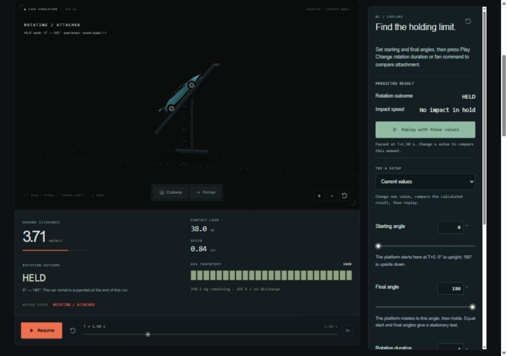
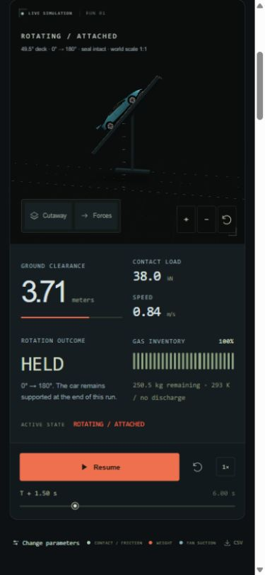

# Rotating Invert review

Local browser review completed 2026-10-19. No deployment performed.

- Desktop: 1280 × 900. Phone emulation: 390 × 844.
- Default: live 0° → 180° / 4 s, followed by final hold. Pause/resume and rewind work.
- Reverse and equal-angle configurations reconstruct the expected deck angle.
- Custom 30° → 150° / 6 s shares/reloads exactly; T+1.5 s shows 42.4°.
- Timeline and keyboard plot scrubbing retain the solved car/deck states.
- Invalid duration clears prediction and disables playback; valid input recovers.
- No fan: detachment near 1.726 s, impact at 2.389 s / 8.216 m/s. Car pitch stays at departure while the deck continues to rotate.
- Whole-rig/tracking cameras, cutaway and force vectors checked. Zero contact/fan/friction after detachment.
- CSV: 1,197 finite samples, unchanged gas inventory, separate platform/body angles, zero final clearance.
- HTTP standalone build reaches the same impact endpoint.
- No observed console errors, WebGL error 0, no narrow overflow or nonfinite plot paths.
- Engineering-detail equation and chart accessible label corrected for rotation loads. Build/syntax/whitespace pass; physics unchanged during this review.

## Still open

Actual iOS Safari and hardware touch/pinch; screen-reader use; subjective sound;
final aesthetic approval. Standalone file: loading was not checked. No real vehicle,
attachment hardware or structural impact validation is implied.

