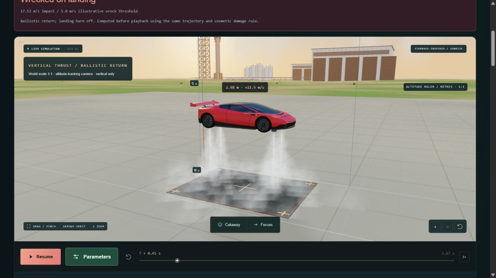

# Parameters access and cold-gas visuals — 21 October 2026

The Parameters entry now sits beside the main experiment action immediately under
the scene. It is a labeled 46 px desktop / 48 px phone control; the top-bar entry
has a larger target too. Both reuse the existing nonmodal panel, pause-on-open,
Escape/close focus return and configuration/inventory preservation.

The supplied photos informed the white cold-gas appearance. The renderer uses
three crossed tapered sheets for each core, 48 deterministic camera-facing cloud
particles per jet and one 60-particle near-ground cloud in Hop. There are no new
textures, remote assets or dependencies. Four balanced Hop mounts remain unchanged.
Launch's four rear outlets share the same procedural treatment.

`coldGasVisual` maps existing delivered flow and thrust to perceptual length,
spread and opacity. Zero flow or thrust suppresses all gas effects. Hop clips its
jet envelope at ground level and fades the ground cloud with height; the underbody
inspection view omits that cloud for visibility. The tracking camera leaves room
below the vehicle, changing continuously with altitude rather than valve state.
Noise and advection use simulation time, so pause/scrub renders are repeatable.
Closing a valve clears the effect immediately; there is no persistent plume history.

These effects are schematic. White visibility, jet dimensions, cloud motion and
ground spread are artistic choices, not condensation, CFD or plume-interaction
calculations. Physics, nozzle outputs, effective area and CSV values are unchanged.

## Verification

- Full suite: 148 passed. Final Hop/scene focused checks after the camera refinement:
  14 passed. Build and browser app/scene syntax checks passed.
- Native WebGL compiled the new shaders. Twelve Launch/Hop camera/size cases plus
  Hop cutaway/vectors returned WebGL error 0. They cover 1120 × 630 and 390 × 460
  canvas sizes, active/near-pad/underbody views and closed-valve coast.
- Returning to the same Hop time/view produced identical exported PNG bytes.
- Actual app desktop and 390 px viewport: the large button opens/closes the panel;
  no horizontal overflow (1265/1265 and 375/375 client/scroll width, respectively;
  the latter has a 15 px scrollbar). Desktop target measured 136 × 46 px and phone
  target 154 × 48 px. Inspected Launch, Hop, Invert cutaway/vectors and Turn.
- No browser warnings/errors observed during the final app checks. CPU submission
  timings in the fixture are not GPU frame-rate measurements.

Evidence is in `../share/plumes-20261021/`, including `verification.json`, native
canvas exports and actual application screenshots. To repeat the fixture, build
the app and copy `tests/browser/plume-check.html` to `dist/plume-check.html`, then
serve normally. The fixture is not included in the production build.

Physical iOS/touch, subjective visual approval and listening remain user checks.
This revision is local only; no deployment or social publication was performed.
